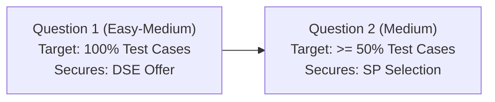

# 20-Day Infosys DSE & Specialist Programmer PYQ Preparation Plan
### Target Roles: Digital Specialist Engineer (DSE) & Specialist Programmer (SP)
**Language:** Java 17 | **Daily Commitment:** 3.0 – 4.0 Hours

---

## 🎯 Strategic Objective

1. **Question 1 Strategy (DSE Qualifier):** Solve one Easy–Medium coding question with **100% test cases**. Focus: Subarrays, Prefix Sums, Difference Arrays, Hashing, and Intervals.
2. **Question 2 Strategy (Specialist Programmer Qualifier):** Secure **at least 50% partial scoring** on a Medium problem via brute-force or subtask handling, and optimize towards 100%. Focus: Binary Search on Answer, 2D Matrix Prefix Sums, Greedy Scheduling.
3. **Question 3 (Hard):** Low priority during this 20-day sprint.

---

## 📅 20-Day PYQ Schedule

### 🧱 Phase 1: Arrays, Subarrays, Prefix Sum & Hashing (Days 1–5)
*Target: Guarantee 100% marks on Question 1 core variations*

- **Day 1: 1D Prefix Sums & Zero-Loss Subarrays**
  - Theory: Prefix Sum concept, $O(N)$ vs $O(N^2)$, `long` overflow protection.
  - Assigned Problems:
    - [Q01-Subarray-Energy-Balance](file:///c:/Users/Administrator/infosys-placement-preparation-2026/Q1-EASY-MEDIUM/02-Subarrays-Prefix-Sum/Q01-Subarray-Energy-Balance/problem.md) *(Candidate-reported PYQ)*
    - [Q02-Zero-Loss-Trading-Window](file:///c:/Users/Administrator/infosys-placement-preparation-2026/Q1-EASY-MEDIUM/02-Subarrays-Prefix-Sum/Q02-Zero-Loss-Trading-Window/problem.md) *(Candidate-reported PYQ)*

- **Day 2: Balanced State & Frequency Counting**
  - Theory: Mapping binary states ($0 \to -1$) for equilibrium lookups, running frequency maps.
  - Assigned Problems:
    - [Q03-Balanced-Server-Telemetry](file:///c:/Users/Administrator/infosys-placement-preparation-2026/Q1-EASY-MEDIUM/02-Subarrays-Prefix-Sum/Q03-Balanced-Server-Telemetry/problem.md) *(Candidate-reported PYQ)*
    - [Q04-Battery-Storage-Target-Count](file:///c:/Users/Administrator/infosys-placement-preparation-2026/Q1-EASY-MEDIUM/02-Subarrays-Prefix-Sum/Q04-Battery-Storage-Target-Count/problem.md) *(Verified PYQ)*

- **Day 3: Modular Arithmetic in Range Queries**
  - Theory: Remainder equivalence $((S \pmod K) + K) \pmod K$ to prevent negative Java remainder bugs.
  - Assigned Problems:
    - [Q05-Dividend-Yield-Divisible-By-K](file:///c:/Users/Administrator/infosys-placement-preparation-2026/Q1-EASY-MEDIUM/02-Subarrays-Prefix-Sum/Q05-Dividend-Yield-Divisible-By-K/problem.md) *(Candidate-reported PYQ)*
    - [Q06-Thermal-Equilibrium-Pivot](file:///c:/Users/Administrator/infosys-placement-preparation-2026/Q1-EASY-MEDIUM/02-Subarrays-Prefix-Sum/Q06-Thermal-Equilibrium-Pivot/problem.md) *(Verified PYQ)*

- **Day 4: Difference Arrays & $O(1)$ Range Updates**
  - Theory: Difference arrays (`diff[L] += V`, `diff[R+1] -= V`), avoiding $O(N \times Q)$ TLE.
  - Assigned Problems:
    - [Q07-Satellite-Bandwidth-Difference-Array](file:///c:/Users/Administrator/infosys-placement-preparation-2026/Q1-EASY-MEDIUM/02-Subarrays-Prefix-Sum/Q07-Satellite-Bandwidth-Difference-Array/problem.md) *(Candidate-reported PYQ)*
    - [Q13-Fleet-Cargo-Overload-Check](file:///c:/Users/Administrator/infosys-placement-preparation-2026/Q1-EASY-MEDIUM/02-Subarrays-Prefix-Sum/Q13-Fleet-Cargo-Overload-Check/problem.md) *(Candidate-reported PYQ)*

- **Day 5: Maximum Subarrays & Parity Transformations**
  - Theory: Kadane's algorithm variations with all-negative constraints; parity reduction.
  - Assigned Problems:
    - [Q08-Smart-Toll-Maximum-Gain](file:///c:/Users/Administrator/infosys-placement-preparation-2026/Q1-EASY-MEDIUM/02-Subarrays-Prefix-Sum/Q08-Smart-Toll-Maximum-Gain/problem.md) *(Verified PYQ)*
    - [Q09-Sensor-Parity-Balance](file:///c:/Users/Administrator/infosys-placement-preparation-2026/Q1-EASY-MEDIUM/02-Subarrays-Prefix-Sum/Q09-Sensor-Parity-Balance/problem.md) *(Candidate-reported PYQ)*
    - [Q10-Corporate-Audit-Positive-Momentum](file:///c:/Users/Administrator/infosys-placement-preparation-2026/Q1-EASY-MEDIUM/02-Subarrays-Prefix-Sum/Q10-Corporate-Audit-Positive-Momentum/problem.md) *(Candidate-reported PYQ)*

---

### ⏱️ Phase 2: Strings, Sorting, Greedy & Intervals (Days 6–9)
*Target: Interval scheduling and greedy choice rules for Q1 & early Q2*

- **Day 6: Greedy Pairings & Sorted Arrays**
  - Theory: Two pointers from extremes on sorted inputs, capacity constraints.
  - Assigned Problems:
    - [Q01-Warehouse-Drone-Allocation](file:///c:/Users/Administrator/infosys-placement-preparation-2026/Q1-EASY-MEDIUM/06-Two-Pointers-Sliding-Window/Q01-Warehouse-Drone-Allocation/problem.md) *(Candidate-reported PYQ)*

- **Day 7: Interval Overlaps & Resource Allocation**
  - Theory: Minimum platforms/cooling racks, independent arrival/departure sorting.
  - Assigned Problems:
    - [Q01-Server-Cooling-Scheduler](file:///c:/Users/Administrator/infosys-placement-preparation-2026/Q1-EASY-MEDIUM/05-Sorting-Greedy-Intervals/Q01-Server-Cooling-Scheduler/problem.md) *(Verified PYQ)*
    - [Q01-Resource-Reservation](file:///c:/Users/Administrator/infosys-placement-preparation-2026/Q2-MEDIUM/04-Greedy-Interval-Optimization/Q01-Resource-Reservation/problem.md) *(Candidate-reported PYQ)*

- **Day 8: Telemetry Divisibility & Length Constraints**
  - Theory: Subarray remainder cycles with minimum length threshold $\ge 2$.
  - Assigned Problems:
    - [Q11-Telemetry-Remainder-Cycle](file:///c:/Users/Administrator/infosys-placement-preparation-2026/Q1-EASY-MEDIUM/02-Subarrays-Prefix-Sum/Q11-Telemetry-Remainder-Cycle/problem.md) *(Verified PYQ)*

- **Day 9: Bitwise XOR Prefix Cancellation**
  - Theory: $\bigoplus$ prefix sums, finding subarrays with XOR sum = 0.
  - Assigned Problems:
    - [Q14-Subarray-XOR-Telemetry-Zero](file:///c:/Users/Administrator/infosys-placement-preparation-2026/Q1-EASY-MEDIUM/02-Subarrays-Prefix-Sum/Q14-Subarray-XOR-Telemetry-Zero/problem.md) *(Candidate-reported PYQ)*

---

### 🔍 Phase 3: Two Pointers & Sliding Window (Days 10–12)
*Target: Telemetry buffers and character frequency bounds*

- **Day 10: Dynamic Sliding Window with Distinct Limits**
  - Theory: Window expansion (right pointer) and contraction (left pointer) with frequency arrays.
  - Assigned Problems:
    - [Q02-Network-Signal-Peak-Window](file:///c:/Users/Administrator/infosys-placement-preparation-2026/Q1-EASY-MEDIUM/06-Two-Pointers-Sliding-Window/Q02-Network-Signal-Peak-Window/problem.md) *(Verified PYQ)*

- **Day 11: Sliding Window Capacity Optimization**
  - Practice fixed and variable window subsegment extraction.

- **Day 12: Phase 1 & 2 Review Assessment**
  - Retrospective in [WEAK-AREAS.md](file:///c:/Users/Administrator/infosys-placement-preparation-2026/WEAK-AREAS.md) & [SCORECARD.md](file:///c:/Users/Administrator/infosys-placement-preparation-2026/SCORECARD.md).

---

### 🎯 Phase 4: Binary Search & Answer-Space Problems (Days 13–14)
*Target: Master the #1 Question 2 Medium pattern for Specialist Programmer*

- **Day 13: Binary Search on Monotonic Answer Space**
  - Theory: Predicate function feasibility checking, integer ceiling division `(A + V - 1) / V`, partial subtask vs full search space.
  - Assigned Problems:
    - [Q01-Sensor-Threshold-Tuning](file:///c:/Users/Administrator/infosys-placement-preparation-2026/Q2-MEDIUM/03-Binary-Search-on-Answer/Q01-Sensor-Threshold-Tuning/problem.md) *(Candidate-reported PYQ)*

- **Day 14: Workload Partitioning across Distributed Nodes**
  - Theory: Minimizing maximum workload assigned to $K$ contiguous workers (Painter's Partition / Task Scheduler).
  - Assigned Problems:
    - [Q02-Distributed-Task-Scheduler](file:///c:/Users/Administrator/infosys-placement-preparation-2026/Q2-MEDIUM/03-Binary-Search-on-Answer/Q02-Distributed-Task-Scheduler/problem.md) *(Verified PYQ)*

---

### 💻 Phase 5: Q2 Medium Patterns — 2D Matrix, DP, Graphs & Subtasks (Days 15–17)
*Target: Partial scoring extraction on harder Medium problems*

- **Day 15: 2D Matrix Prefix Sums & Subgrid Range Queries**
  - Theory: Preprocessing $R \times C$ matrices for $O(1)$ subgrid queries, inclusion-exclusion principle.
  - Assigned Problems:
    - [Q12-Power-Substation-2D-Matrix](file:///c:/Users/Administrator/infosys-placement-preparation-2026/Q1-EASY-MEDIUM/02-Subarrays-Prefix-Sum/Q12-Power-Substation-2D-Matrix/problem.md) *(PYQ-style)*
    - [Q01-Subgrid-Power-Optimization](file:///c:/Users/Administrator/infosys-placement-preparation-2026/Q2-MEDIUM/05-Matrix-and-2D-Prefix-Sum/Q01-Subgrid-Power-Optimization/problem.md) *(Candidate-reported PYQ)*

- **Day 16: Partial Scoring Tactics & Subtask Exploitation**
  - Theory: Writing $O(N^2)$ brute-force prefix sweeps to guarantee 50% test cases on Medium problems.
  - Assigned Problems:
    - [Q15-High-Frequency-Arbitrage-Bounds](file:///c:/Users/Administrator/infosys-placement-preparation-2026/Q1-EASY-MEDIUM/02-Subarrays-Prefix-Sum/Q15-High-Frequency-Arbitrage-Bounds/problem.md) *(Candidate-reported PYQ)*

- **Day 17: Linear DP & State Transitions**
  - Theory: Avoiding recursion overhead, 1D tabular transitions, greedy vs DP choice.

---

### 🏁 Phase 6: Timed Mock Assessments & Final Revision (Days 18–20)
*Target: Full exam readiness under 3-hour strict simulation*

- **Day 18: Timed Mock Test 01 (3 Hours)**
  - Full simulation using [mock-tests/Mock-Test-01](file:///c:/Users/Administrator/infosys-placement-preparation-2026/mock-tests/Mock-Test-01/README.md).
  - Target: Q1 100% pass (45 mins) + Q2 $\ge 50\%$ pass (75 mins).

- **Day 19: Mistake Log Remediation & Speed Hardening**
  - Deep-dive into [WEAK-AREAS.md](file:///c:/Users/Administrator/infosys-placement-preparation-2026/WEAK-AREAS.md).
  - Practice fast I/O (`BufferedReader` / `StringTokenizer`) for large test cases.

- **Day 20: Final Strategy Lock-in & Formula Review**
  - Final review of all template codes, corner cases, and exam game-plan.
